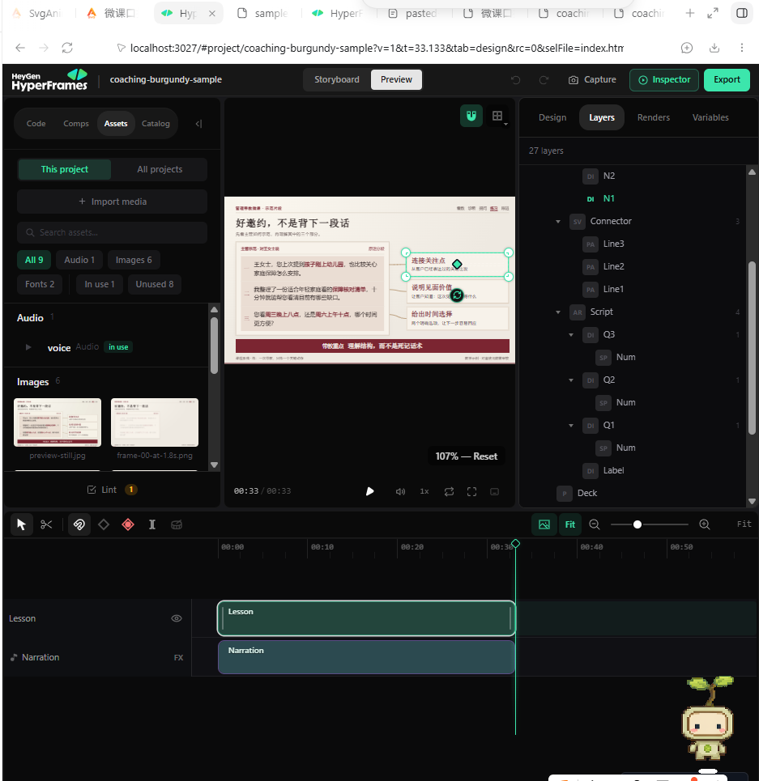
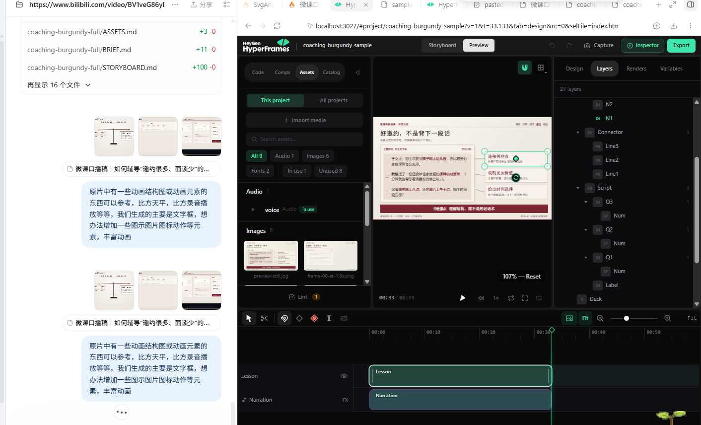

# 课件编辑器：聊天记录与截图依据

资料编号：S15。内容日期及收录日期：2026-09-20。状态：已读取正文与两张截图；未操作截图中的参考系统。

来源：[AI内容协作平台需求沟通群 2026年09月20日](https://alidocs.dingtalk.com/i/nodes/Obva6QBXJw9KA21jiLQKPlYrWn4qY5Pr)。由用户提供，用于课件编辑器可行性分析与需求起草。正文通过已连接的钉钉文档只读接口读取，本轮重新读取后与上一轮内容一致；截图为原文引用图片，已目视读取并保存原文件。未访问其他群消息，未核验截图中工具的实际操作。原文中的带令牌“回到会话”链接不收录。

## 1. 正文摘录

以下保留消息文字、署名及时间，版式改为Markdown；并非完整群聊导出。

**朱萍萍，2026-09-20 14:30**：发布截图1。

**朱萍萍，2026-09-20 14:30**：生成后预览直接进入这个界面，可以在这里调整

**朱丹，2026-09-20 14:31**：编辑工作台

**朱萍萍，2026-09-20 14:31**：确认后就可以导出视频

**朱萍萍，2026-09-20 14:31**：发布截图2。也可以在对话框直接提出修改

**陈丰，2026-09-20 14:32**：😂相当于内置了个剪辑工具， 就好像豆包现在新出的，豆包直接链接剪映，自动剪辑

**朱丹，2026-09-20 14:33**：是的，我们也要实现这种剪辑工具的支持

“豆包直接链接剪映”为参与者类比，未经独立核验，不作为本平台必须集成剪映或相关产品能力已存在的证据。

## 2. 原图及可见范围

### 截图1：编辑工作台

[原图地址](https://static.dingtalk.com/media/lQLPJx_Zd8gYRDvNA8XNA6mwvbHEBuNNhKoKgP7XyS6FAA_937_965.png)。可见HeyGen HyperFrames名称、素材库、画布、图层、Lesson和Narration时间轨及Export按钮。可见地址为本地localhost；不能据此认定已部署团队服务或已接入本项目。

### 截图2：对话与工作台并排

[原图地址](https://static.dingtalk.com/media/lQLPKHCvkhHtuPvNA1jNBYSwXr2WIMbJNsMKgP8iFwk5AA_1412_856.png)。左侧为对话和文件变动展示，右侧为工作台；对话可辨识出“增加图示、图片、图标动作”等意图。两个区域并排不证明已实现自动双向同步，也未验证修改结果。

## 3. 关联分析

详细业务分析、建议方案及验收见[课件编辑器需求说明](../../../03_功能设计/课件编辑器-需求说明.md)。需求方向来自聊天，具体规则是待评审设计；与现有只读画布边界的差异见Q26，不能按日期自动覆盖旧共识。
