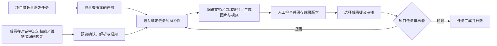

# AI课件协作平台迭代需求文档

> 2026-09-28 D057：本轮工作台组件按用户指定的 Beautiful UI 源码适配重设计，继承D056单模块与会话布局。具体组件及交互见[当前UI方案](../03_功能设计/AI协作独立工作台-UI重构方案.md)，不改变本文业务范围。
**当前UI设计范围（D056，2026-09-28）：** 本轮设计只保留内容协作智能体，移除第二层面包屑；左侧为会话记录和加号新增，同行展示进行中/已完成执行状态图标，压缩成果条并加宽对话。替代D054的左侧业务任务列表解释；其他项目需求不据此次设计收敛删除。详见UI重构方案v0.3。

**2026-09-28 B方案深化（D054）：** 用户认可灵感工作室整体布局，要求左侧紧凑任务列表（名称、状态），底部文档图标加名称、图片缩略图、视频首帧缩略图及竖排可取消类型筛选。具体交互与本轮原型见UI重构方案第8节；其余业务规则继承。

**2026-09-28 UI方向补充（D052）：** 用户明确将AI协作打包为独立模块，由现有系统右上角“AI协作”进入全新UI系统，包含资源管理、智能体配置、内容协作智能体。本补充替代I01中沿用旧系统视觉框架的限制；其余已确认业务规则继续有效。三种候选风格见[UI重构方案](../03_功能设计/AI协作独立工作台-UI重构方案.md)，具体风格尚未选定。

版本：v0.3｜日期：2026-09-24｜状态：本轮需求规则已按用户修正确认，可进入功能设计；模型接入与效果仍待实测

## 1. 文档定位与设计口径

用户给出的[八项迭代方向](../01_业务资料/外部材料/2026-09-24-迭代需求清单/原始需求截图.png)全部纳入本稿。本稿以[业务共识](AI课件协作平台-业务流程与需求共识.md)、[需求梳理R01—R19](AI课件协作平台-项目需求梳理.md)、[现有页面功能清单](../03_功能设计/AI课件协作平台-页面与功能清单.md)、[课件编辑器](../03_功能设计/课件编辑器-需求说明.md)、[任务管理](../03_功能设计/任务管理-需求说明.md)和[项目与系统管理](../03_功能设计/项目与系统管理-需求说明.md)为基础。v0.2先给出八项完整需求方案；用户本轮明确修正I02、I04、I05，并表示其余内容没有问题。本稿据此作为本轮功能设计输入；这不表示模型服务、技能执行或权限后端已经实现。

本次范围为 I01—I08 八项；不包括学习平台对接、批量生产、多人同时编辑同一成果、完整专业剪辑器。需求池收集001（区域拖拽）、002（上传格式）、003（整类资源关联）、004（技能自动运行验证）保持各自来源与状态：本稿只处理八项必需的交叉接口，不将四项自动并入本迭代。上线日期、工时、负责人和优先级不在本稿推定。

### 1.1 角色和对象

| 名称 | 本稿定义 |
|---|---|
| 项目成员 | 有当前项目访问权的账号；查看分配给自己的制作任务，使用获授权的AI协作能力和项目资源。 |
| 项目管理员 | 当前项目的任务管理角色；可在该项目添加、编辑、分配、查看和管理制作任务。与原“部门主管”在任务业务上的对应关系以本稿第10节方案为准。 |
| 技能维护者 | 按D042获得相应技能编辑/更新权限的主管；全局技能在系统管理维护，项目专属技能在所属项目维护。项目成员可通过智能体新建项目专属技能，现有技能的编辑更新仍按主管审核规则处理。 |
| 系统管理员 | 配置账号、项目成员关系、角色与权限；默认不读取项目业务内容，不代替任务审核者。 |
| 制作任务 | 管理创作目标、负责人、交付要求和审核状态的业务对象。 |
| 创作会话/执行记录 | 会话保存对话上下文；执行记录保存一次模型或工具调用及结果。两者不能当作制作任务。 |
| 成果版本 | 文档、图片、视频的一次可识别输出或保存；任务提交审核时固定其中一个或多个版本。 |

### 1.2 本迭代共同原则

1. 资源、任务、会话及成果按项目隔离。全局技能在所有项目可见且状态由系统侧控制；项目专属技能仅所属项目可使用，项目成员可从本项目会话沉淀新技能；后续编辑更新按技能维护权限处理。引用资料、后台执行、预览、下载和历史版本均按同一项目与对象权限校验。
2. AI生成、文档保存、成果入库、提交审核、审核通过为不同事件。生成成功不自动入库或完成制作任务；任务只有审核通过才完成并计入成品，沿用D043。
3. 人工可确认AI候选内容。AI编辑文档、生成图片/视频或改写技能时，提交目标与结果需可回看；失败不覆盖最后一次成功内容。
4. 文档、图片、视频、技能调用均需保存项目、任务（如来自任务）、会话、操作者、来源版本、状态与时间。后台晚到结果归属发起时的对象，不按回调时浏览器正在查看的任务归属。

## 2. I01 AI协作UI视觉优化（R08，PG11）

### 2.1 目标与范围

现有PG11由全局导航、会话任务列表、聊天、内容画布、成果清单组成。本项优化这五个区域及其任务上下文展示，沿用项目[系统设计规范](../04_原型与说明/系统设计规范.md)的字体、颜色、控件和间距。初始态、文档、图片、视频、生成中、失败、无成果及窄窗口都属于设计与验收范围；不重建项目导航结构。截图未提出拖拽改变区域宽度，收集001继续独立跟踪。

### 2.2 需求规则

| 编号 | 功能要求 |
|---|---|
| I01-01 | 在初始态突出当前项目、当前会话及输入区；有成果时保持会话任务列表、聊天、画布、成果清单同时可识别。任务来源会话显示任务名称和返回任务详情入口。 |
| I01-02 | 当前选中的会话、成果和内容类型使用一致的选中反馈；生成中、失败、待人工确认与已完成状态不能只靠颜色区分。后台会话完成时更新所属行，不抢占当前画布。 |
| I01-03 | 聊天、画布、成果清单分别滚动；成果清单名称过长可查看全名。进入画布全屏、退出后保留当前成果及浏览位置；不清空未发送草稿。 |
| I01-04 | 窗口宽度不足时优先保证聊天输入和当前成果可用，辅助区域可折叠；折叠与展开不改变会话、任务或已选成果。设计稿需提供正常桌面、窄窗口和各错误状态，而非仅一张理想态截图。 |
| I01-05 | 按现有系统规范统一按钮层级、空态、加载、错误与禁用文案；没有真实进度值的AI执行不得展示伪百分比。 |

**验收：** 原型及实际页面逐状态对照设计规范；切换会话、成果、折叠区域、画布全屏与返回后，任务归属、草稿和选中项正确；窄窗口仍可提交对话和查看当前成果。

## 3. I02 文档在线编辑（R08/R09，PG11）

### 3.1 本迭代对象与入口

本迭代只编辑**智能体生成并归属当前项目的Markdown（.md）文档成果**，入口为成果清单的Markdown文档卡片及画布“编辑”。其他格式的生成文档和资源库上传的原文件仍按原规则查看或下载，不提供编辑入口。生成Markdown文档原来在PG11只读，本项使其具备内容编辑与续做；这与课件编辑器的场景/时间轴工程是两种对象。

### 3.2 编辑、保存和版本

| 编号 | 功能要求 |
|---|---|
| I02-01 | 画布有“预览／编辑”两态。编辑态直接修改Markdown源码，预览态按Markdown渲染；用户可编写标题、段落、列表、链接等Markdown内容，无单独富文本工具栏或复杂格式编辑器。切换预览不保存，保存须显式完成。 |
| I02-02 | 首次编辑生成独立的可编辑文档记录，关联原生成成果、项目、会话与制作任务。后续保存形成递增版本；每版记录保存人、时间和摘要。原生成结果保留，不因手工编辑被抹除。 |
| I02-03 | 编辑时显示“未保存／保存中／已保存／保存失败”。切换文档、会话或离开页面前如有未保存改动，提示保存、放弃或取消离开。保存成功后刷新/再次进入恢复对应版本；保存失败保留本次输入并允许重试。 |
| I02-04 | 服务端以版本号拒绝过期写入。同一文档在另一标签页已更新时，当前编辑者看到冲突提示，可保留自己的草稿、查看最新版并决定重新编辑；不静默覆盖。 |
| I02-05 | 使用“围绕此内容提问”时，将当前Markdown文档及选定版本作为上下文；AI建议修改先形成Markdown候选版本，由成员查看文本差异后应用或放弃。应用产生新版本，不直接改写正在编辑的源码。 |
| I02-06 | 文档保存不自动加入资源库。成员可按既有手动入库流程把选定版本作为.md文件保存到当前项目的文档资源；任务提交审核时固定版本快照，后续编辑不改变已提交内容。不承诺DOCX/PDF等格式的在线编辑或往返转换。 |

**权限与异常：** 仅文档所属项目中有该会话/任务创作权限的成员可编辑；有查看权而无编辑权的人员看到只读态。内容为空、源文档失效、网络中断、版本冲突、资源入库失败分别提示处理方式；入库失败不回滚已保存的编辑版本。

**验收：** 打开AI生成的.md成果，修改Markdown正文并切换预览，保存后刷新仍得到相同源码和预览；两标签页的过期版本不能覆盖新版本；未保存离开有提示；审核中的版本不会因后续编辑变化；非.md成果与上传原文件不出现编辑入口；无权用户无法读取或保存。

## 4. I03 图片局部固定提问（R08，PG11）

### 4.1 核心行为

成员查看图片成果时选择矩形区域，系统在原图上保留可见锚点；输入框显示“围绕所选区域提问”，提交后消息同时携带**图片成果ID、图片版本和归一化区域坐标**。AI回复针对所选区域解释或提出修改建议。原整图“围绕此内容提问”继续保留；未选区域时仍是整图提问。本项不自动执行局部重绘，用户明确提出修改图片时由现有或后续图片编辑能力另行生成新成果。

| 编号 | 功能要求 |
|---|---|
| I03-01 | 在图片画布开启“选择区域”后拖选矩形；发送前可移动、调整或清除区域。只允许在图像实际边界内选择，空区域不能发送为局部问题。 |
| I03-02 | 缩放、适应画布及全屏只改变显示比例，锚点仍指向相同图像内容；可在聊天消息点击“查看区域”回到该图片及区域。 |
| I03-03 | 一条消息绑定一个区域；成员可通过再次发送另一个区域问题实现多处讨论。新生成图片拥有新成果ID，旧锚点不自动迁移到新图。 |
| I03-04 | 图片加载失败、原图被移除或权限失效时，消息仍保留文字和原目标信息，但不展示错误图片；提示区域暂不可定位。 |

**验收：** 同一图片局部提问后，在缩放、全屏、切换成果、刷新后可从消息准确回定位；换图不会复用旧坐标；无权访问该图的账号无法通过消息引用读取原图。

## 5. I04 AI创建和编辑技能（R10，PG13/PG18）

### 5.1 对话入口与共享范围

项目成员在当前项目的AI协作会话中，可以对智能体提出“把这次制作经验整理成技能”“以后遇到同类问题按刚才的方法处理”等要求。智能体以**当前会话中已发生的实践过程和用户明确指定的范围**为来源，归纳可复用的目标、适用条件、输入、步骤、输出和注意事项，生成项目专属技能草稿。用户可补充、删改并确认保存；保存成功后，该技能出现在本项目技能列表与智能体技能选择器，供同项目其他成员使用。不能因一句普通问题或一次生成成功就自动创建并共享技能。

对话沉淀默认只作用于当前项目。全局技能仍由有权主管在系统管理维护；项目技能不因“供其他人使用”而跨项目传播。已存在技能的AI辅助编辑也可在对话中提出，但普通成员的修改只形成更新申请，由有权主管审核后生效，沿用D042；有维护权限的主管可按I06更新版本。

### 5.2 经验提取、确认与保存

| 编号 | 功能要求 |
|---|---|
| I04-01 | 识别用户明确的技能沉淀意图后，智能体从当前会话提取任务背景、有效做法、人工修正、失败及解决方式、最终可复用结论；不把全部聊天原样复制成技能，也不把尚未验证的尝试写成成功经验。 |
| I04-02 | 生成技能草稿，至少含名称、用途/适用场景、所需输入、执行步骤、输出与检查点、限制及来源会话。首轮产出Markdown技能说明，不自动生成或执行脚本；需要脚本的扩展走技能维护流程。 |
| I04-03 | 对话中展示草稿全文及“编辑、重新总结、保存到本项目、放弃”。保存前明确展示共享范围为“本项目成员可使用”；由发起用户确认，确认前不进入共享技能库。用户可删去不应被其他成员看到的会话细节。 |
| I04-04 | 保存时校验项目权限、名称冲突、入口格式及内容有效性。通过后形成项目专属技能版本并启用供本项目成员选择；失败保留草稿和原会话，不产生半成品共享记录。保存成功在当前会话中给出技能名称、归属项目及打开详情入口。 |
| I04-05 | 保存技能的来源会话、创建人和时间可追溯；其他成员使用技能时看到可共享的技能正文，不因此取得源会话的阅读权。源会话后续修改不自动重写已保存技能；再次沉淀或修改形成新候选/版本。 |
| I04-06 | 用户在对话中要求修改已有技能时，智能体固定现有版本并展示差异。有维护权者可确认更新；普通成员可提交更新申请，审核通过后发布；失败或驳回保持旧版可用。 |

**验收：** 项目成员在会话中提出沉淀要求，智能体基于实际对话生成草稿，用户确认后本项目另一成员能在技能列表和选择器找到并使用；未确认、解析失败或放弃时他人不可见；他人不能借技能查看源会话；项目B看不到项目A专属技能；普通成员不能直接覆盖已生效技能或发布全局技能。

## 6. I05 文生图、图生视频基础能力（R04/R08/R14，PG11）

### 6.1 统一生成流程

两种生成在当前项目的AI协作会话中发起，可继承制作任务上下文。用户以自然语言表达“生成一张……图片”“让这张图动起来并生成视频”等意图，智能体先识别目标内容类型和引用素材，再调用**专用文生图模型**或**专用图生视频模型**。用户无需先在界面手动切换生成模式；意图明确且输入齐全时直接执行，目标不明或图生视频缺少源图时先向用户追问，不擅自调用模型。普通聊天模型负责意图识别和参数整理，媒体生成由专用模型完成，不能用普通文本回答或静态演示文件冒充生成结果。

发起后创建执行记录，依次显示排队、执行中、成功或失败。用户离开页面后执行继续；结果回到发起会话的成果清单，保留用户原话、识别出的意图、实际调用的专用模型/工具、来源素材和生成时间。用户可预览、继续提问、手动入库或作为任务交付材料。生成不自动入库、不自动提交审核。

### 6.2 文生图

| 编号 | 功能要求 |
|---|---|
| I05-01 | 用户在对话中表达生图意图和画面要求；智能体识别后整理为专用文生图模型的请求，可引用当前项目有权使用的文档或图片作为参考。仅提出知识性问题时不触发生图；要求不清或引用失效时追问或提示修正。 |
| I05-02 | 每次请求调用专用文生图模型并产生独立执行记录和结果；成功后图片可完整预览、缩放及按I03提问。保存意图识别结果、模型/工具、实际输入、参考素材版本与生成图片标识。 |
| I05-03 | 生成失败或超时保留原请求，可原样重试或修改后重发；重试是新执行，不能把失败结果显示为成功，也不能用旧演示图替代新输出。 |

### 6.3 图生视频

| 编号 | 功能要求 |
|---|---|
| I05-04 | 用户在对话中表达让图片生成视频的意图；智能体优先识别消息中引用或当前明确选中的一张图片，缺少或存在多张候选时请用户指定。确定源图和运动/镜头要求后调用专用图生视频模型；源图项目、版本及权限在提交和后台取材时均校验。 |
| I05-05 | 成功后提供可播放的视频成果，记录识别出的意图、源图、要求、专用模型/工具、实际视频文件及元信息；从视频可回看源图。视频可按现有规则反馈、下载（如已有权限）和手动入库。 |
| I05-06 | 源图失效、服务拒绝、生成失败、超时或结果文件不可播放时明确显示失败及重试入口；保留此前成功的视频，不自动完成制作任务。 |

**质量与接入边界：** 专用图片/视频模型及供应服务、输出尺寸/时长、并发、费用与样片标准依Q10—Q12由研发实测和业务样片评审确定；本稿不杜撰数值。功能验收需检查自然语言意图识别、正确路由到专用模型、真实返回的可查看图片/可播放视频及完整归属链路；画质另使用业务认可样片。技能包存在不等于平台已接入真实服务。

## 7. I06 技能新增、编辑、调用优化（R10，PG13/PG18）

### 7.1 维护与状态

本项将既有技能包维护、I04从会话沉淀的新技能和智能体实际调用连成一条链。手动上传ZIP/入口文件与对话生成的Markdown技能说明进入同一格式解析和项目隔离校验。继续保留全局技能与项目专属技能两类，类型由新增入口或对话所在项目确定，编辑时不转换类型；项目内全局技能只读并跟随系统状态。

| 阶段 | 规则 |
|---|---|
| 草稿/候选 | 对话总结的技能候选或未提交的更新申请；仅发起者及授权审核者可见，不可调用。手工表单未提交时不形成生效版本。 |
| 解析中 | 保存后核对入口文件、元数据、附件和安全路径；此阶段不能调用新版本。上传阶段只解析，不执行包内脚本。 |
| 解析失败 | 显示可定位原因，允许修正并重新提交；编辑失败时旧版本保持原启停状态。 |
| 启用 | 新建项目专属技能由创建者在对话中确认保存、解析通过后启用，供本项目成员选择；已有技能更新须按维护/审核权限确认后生效。全局技能按系统管理授权及全局状态生效。 |
| 停用 | 不接受新的调用；既有会话/执行保留所用版本及结果，停用不删除历史。 |

新建项目专属技能的人工确认发生在对话草稿保存前；解析失败时不进入共享库。普通成员不能借此覆盖已有技能，全局技能仍由授权主管维护。需求池收集004的“实际运行验证中/通过/不通过”是独立扩展，不把文件解析冒充技能可运行验证。

### 7.2 新增、编辑和调用规则

| 编号 | 功能要求 |
|---|---|
| I06-01 | 手工上传保留完整入口文件和附件清单；对话新建保存Markdown技能说明及来源信息。两种来源均读取name/description用于列表，入口缺失/重复、损坏、超限或不安全路径阻止生效，保留输入与原因。 |
| I06-02 | 编辑已有技能形成新版本候选；解析/确认完成前，正在使用的旧版不被覆盖。版本记录保存文件、维护人、时间和摘要，历史执行固定引用当时版本。 |
| I06-03 | 智能体技能选择器仅展示当前项目可用的启用技能。手动选择的技能与对话输入一起提交；后台按该请求固定技能版本，执行记录关联技能ID、版本、操作者、任务/会话、状态和实际用量。多技能同时选择按用户确认的列表执行，实际编排与调用顺序由研发设计，不假设技能文字本身能执行脚本。 |
| I06-04 | 技能停用或更新后，新请求使用最新可用版本；已发起执行继续按发起时固定版本处理。删除被任务、会话或成果引用的技能时保留历史可追溯记录，并按既有引用保护规则阻止直接物理删除。 |
| I06-05 | 项目成员可通过I04对话创建并保存本项目新技能；对已有技能的修改进入申请/审核流程，申请未通过不影响已生效版本。全局与项目专属技能的后续维护权限独立校验。 |

**验收：** 项目成员在会话中确认新技能后，本项目其他成员可选用；全局技能状态在项目视图同步，项目A专属技能不进入项目B；新版本解析失败时旧版仍可调用；停用技能不能用于新请求；一次真实调用能追溯所用版本及结果；无权限者无法通过接口直接改写已有技能或调用无权技能。

## 8. I07 任务管理和分配流程（R07，PG19）

### 8.1 本迭代角色与字段

项目管理员可在当前项目添加、编辑、分配、查看全部制作任务并处理审核；项目成员仅查看分配给自己的任务、进入智能体创作、选择成果提交审核。为把原D044“主管管理全部任务”与D049“项目管理员派工”合成可设计规则，本稿默认**具备项目管理员权限者也是该项目的任务审核者**；系统管理员不自动获得该权。后续业务若要分离派工与审核，只需拆分权限点，不改变任务对象和流程。

| 字段 | 要求 |
|---|---|
| 任务名称 | 必填，能清楚识别创作目标；项目内同名允许，但系统生成唯一任务编号。 |
| 创作要求 | 必填，说明内容主题、目标受众与主要要求，供成员创作与审核者对照。 |
| 交付类型与要求 | 必填，选择一个主要交付类型（文档、图片、视频或课件）并说明审核标准；可附多个参考或支持材料，但每个任务只指定一份主要交付成果。 |
| 负责人 | 必填，首轮一个当前项目有效成员；多人协作以会话参与记录保留，单任务多人共同负责留待后续扩展。 |
| 参考资源 | 可选，仅能选当前项目有权访问的资源；资源失效后标记并提示替换。 |
| 截止时间、优先级 | 可选；未填不阻止分配。逾期是基于时间的标记，不另造互斥状态。 |
| 系统记录 | 项目、编号、创建/编辑/分配人及时间、要求版本、负责人历史、关联会话、成果版本、提交与审核记录。 |

### 8.2 状态与操作

| 状态 | 允许的主要操作 | 后续状态 |
|---|---|---|
| 草稿 | 管理员编辑、删除、发布并分配；成员不可见 | 待开始 |
| 待开始 | 负责人查看、进入智能体创作；管理员编辑或改派 | 创作中 |
| 创作中 | 负责人继续创作并选择成果提交；管理员编辑或改派 | 待审核 |
| 待审核 | 审核者查看固定成果版本并通过或填写意见退回；负责人可查看审核状态，不可替换本次提交快照 | 已完成／待修改 |
| 待修改 | 负责人查看退回原因并继续原任务；再次提交形成新审核记录 | 创作中／待审核 |
| 已完成 | 查看成果、审核与过程记录；管理员归档 | 已归档 |
| 已归档 | 授权人员查看历史；恢复需管理员操作并记录原因 | 恢复至归档前状态 |
| 已取消 | 查看取消原因和历史记录，不可继续创作或提交 | 终止 |

管理员可以取消尚未完成任务，需填写原因并保留已发生的创作和用量；取消任务不可再提交。删除草稿可从常规列表移除；已有分配、创作或审核记录的任务采用逻辑删除，历史证据不物理抹除。具体保留期限与跨期统计展示仍由原Q25追踪。

### 8.3 分配、进入创作与审核

1. 管理员只能选择当前项目有效成员。分配成功后成员“我的任务”出现该任务；分配失败不产生半完成任务。编辑交付要求形成新要求版本并让负责人看到变更；改派保留旧操作者创作与用量。
2. 成员点击“开始/继续创作”进入同项目、同任务的AI协作界面。首次可建会话，续做可选此任务已有会话；一个会话只归属一个任务，一个任务可关联多个会话。任务与会话列表状态分别展示，不混称。
3. 成员从本任务已完成的成果中选择一份**主要交付成果**的固定版本提交，可附加多个支持材料。一个任务审核通过计为**一个完成任务**；主要交付类型为“课件”且审核通过时计入**一份成品课件**，重复导出或同一任务重提不重复计数。文档、图片、普通视频作为主要交付物时任务仍可完成，但不自动算作成品课件；如业务将视频等同课件，应在交付类型规则中明确。历史修订和跨期作废保留原Q20追踪。
4. 审核通过后任务完成；退回需意见，成员续做并重提。审核者不得修改待审核快照，重复点击审核不得重复计数。保存资源或AI执行成功均不触发审核通过。

**验收：** 管理员分配后仅本人可见任务；从任务进入智能体时项目/任务/会话/成果归属一致；退回与重提保留每次审核包；通过后任务完成且计数只发生一次；改派和逻辑删除不抹掉历史。

## 9. I08 项目权限控制（R11/R18，PG02—PG04、PG11、PG13、PG19）

### 9.1 授权模型

每次访问按“账号有效＋当前项目成员关系＋对象归属＋操作权限”判断。全局技能另按全局技能维护授权判断；项目专属技能按所属项目判断。前端隐藏按钮仅改善体验，服务端对列表、详情、搜索、预览、下载、编辑、提交、审核、生成任务和后台回调均做授权校验。系统管理员可维护账号与权限配置，但默认无项目业务内容访问权。

| 操作 | 项目成员 | 项目管理员 | 技能维护者/审核者 | 系统管理员 |
|---|---|---|---|---|
| 进入项目与查看项目资源 | 仅有成员关系的项目 | 仅有管理关系的项目 | 需同时具备项目访问权；全局技能除外 | 配置项目关系，不自动读资源内容 |
| 制作任务列表/详情 | 仅本人负责的任务 | 当前项目全部任务 | 只有另获任务权限时可读 | 默认无业务读取权 |
| 添加/编辑/分配/取消/归档任务 | 无 | 当前项目可操作，保留审计 | 无任务授权时不可操作 | 默认不可操作 |
| 进入AI协作、编辑成果、提交审核 | 本人任务及本人获授权会话 | 如自身是负责人，按成员规则；可只读查看所管理任务成果 | 需另有创作权限 | 默认不可访问 |
| 审核任务 | 无 | 当前项目待审核任务 | 只有另获任务审核权时可操作 | 默认无业务审核权 |
| AI创建/编辑技能、启停/发布 | 可在对话中创建并确认保存本项目新技能；对已有技能提交更新申请 | 可按成员规则创建；编辑、启停已有技能须另获技能维护权 | 按全局/项目专属作用域维护或审核已有技能 | 仅配置权限，不自动发布技能 |
| 查看项目数据统计 | 本人数据及证据 | 当前项目成员数据 | 需另有统计权限 | 默认无绩效数据读取权 |

### 9.2 权限变化与异常

- 项目成员被移除或账号停用后，阻止新的任务访问、文档保存、生成请求、技能调用及成果下载；已成功内容、审核与用量记录保留，管理员处理改派。后台已发起执行继续保留原归属，结果能否向已撤权用户展示由当前权限判断。
- 角色调整后新请求按新权限判断；已打开页面再次写入仍需服务端复核。无权限和对象不存在分别返回适当反馈，不泄露他项目标题、缩略图、文件路径或内容。
- 项目管理员不得给自己增加权限或把非项目成员直接设为任务负责人；项目成员关系变动与任务指派分别记录审计。

**验收：** 使用成员、项目管理员、技能维护者、系统管理员账号分别检查列表和直达链接；项目A内容在项目B不可见；撤权后已打开页面的保存、提交和下载被拒绝；系统管理员不能仅凭系统角色读取任务正文；界面与接口授权结果一致。

## 10. 功能设计交接与实施验证

用户已确认v0.2其余需求方案，并在v0.3明确：只编辑Markdown文档内容；成员通过与智能体对话总结实践经验、确认保存项目技能，供同项目成员使用；智能体识别生图/图生视频意图后调用专用模型。I01、I03、I06—I08沿用v0.2规则，包括项目管理员管理并审核当前项目任务、每任务一份主要交付成果的本轮口径。业务决定已记录为D051；功能设计直接以本稿为当前输入，不再把这些已答复事项反复列作待确认。

研发仍需验证真实文生图/图生视频服务、认可样片、执行环境和容量；技能文件解析与自动运行验证保持不同能力，需求池收集004是否进入同一开发批次按其独立需求处理。技术验证不改变本稿确认的用户流程；若验证发现无法按本稿实现，需提出可审阅的替代方案与影响。

### 10.1 页面与状态清单

| 页面/区域 | 本稿新增或调整的状态 |
|---|---|
| PG11 AI协作 | 初始、任务进入、Markdown源码编辑/预览/未保存/保存失败/版本冲突、图片局部选择/已锚定/定位失效、对话识别技能沉淀意图并预览/确认、识别生图/图生视频意图与专用模型排队/执行/成功/失败、成果清单与画布联动、窄窗口。 |
| PG13/PG18 技能管理 | 手工新增/编辑、对话新建的项目技能展示、解析中/失败、启用/停用、已有技能更新申请/审核、调用记录、无维护权限。 |
| PG19 任务管理 | 我的任务/全部任务、草稿、待开始、创作中、待审核、待修改、已完成、已归档、取消、改派、无权限与空数据。 |
| PG02—PG04及公共权限 | 项目进入、成员关系与角色调整、权限不足、撤权后的重新校验；系统管理员与项目业务权限分离。 |

### 10.2 研发与验收交接

1. 功能设计按I01—I08稳定编号细化页面、接口、字段约束和状态图；继承R编号，不新建重复R需求域。
2. 研发先核对真实认证与项目成员关系、文档可编辑存储、图片/视频服务、技能运行环境及版本能力。对无法实现的默认规则提出替代方案及影响，不以静态原型证明后端已完成。
3. 测试至少覆盖每项的正常、失败、重复操作、权限撤销和跨项目场景。图片/视频质量另按业务认可样片验收；未返回Token或生成费用的数据标缺失，不填零。
4. 本稿完成的是需求细化。业务评审结论、原型通过、排期、开发完成和验收通过分别按证据记录；不因本稿写完自动改变这些状态。

## 11. 来源与历史关系

- 原始八项：[S19迭代需求截图](../01_业务资料/外部材料/2026-09-24-迭代需求清单/原始需求截图.png)。
- 已确认边界：[业务共识](AI课件协作平台-业务流程与需求共识.md)、[决策D040—D050与Q04/Q10—Q33](../00_项目管理/决策与待确认.md)。
- 具体专题：[内容协作智能体](../03_功能设计/内容协作智能体-需求说明.md)、[课件编辑器](../03_功能设计/课件编辑器-需求说明.md)、[任务管理](../03_功能设计/任务管理-需求说明.md)、[项目与系统管理](../03_功能设计/项目与系统管理-需求说明.md)、[协作任务与权限](../03_功能设计/协作任务、数据看板与权限-需求说明.md)。
- 本稿替代的[迭代需求草稿v0.1](../99_归档/2026-09-24-迭代需求草稿v0.1.md)只保留作历史快照；当前需求细化以本稿为入口。
