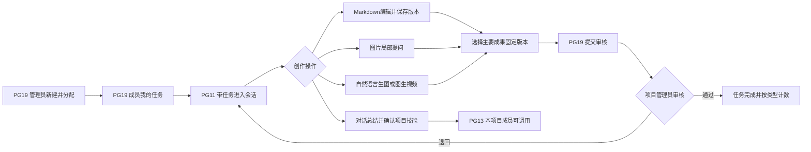

# AI课件协作平台迭代功能设计

> 2026-09-28 D057：本轮工作台组件按用户指定的 Beautiful UI 源码适配重设计，继承D056单模块与会话布局。具体组件及交互见[当前UI方案](../03_功能设计/AI协作独立工作台-UI重构方案.md)，不改变本文业务范围。
**当前UI设计范围（D056，2026-09-28）：** 本轮设计只保留内容协作智能体，移除第二层面包屑；左侧为会话记录和加号新增，同行展示进行中/已完成执行状态图标，压缩成果条并加宽对话。替代D054的左侧业务任务列表解释；其他项目需求不据此次设计收敛删除。详见UI重构方案v0.3。

**2026-09-28 B方案深化（D054）：** 用户认可灵感工作室整体布局，要求左侧紧凑任务列表（名称、状态），底部文档图标加名称、图片缩略图、视频首帧缩略图及竖排可取消类型筛选。具体交互与本轮原型见UI重构方案第8节；其余业务规则继承。

**2026-09-28 后续UI方向（D052）：** 新AI协作系统从现有系统右上角独立进入，三核心模块采用全新UI。本稿的业务流程、权限与状态仍为设计输入；下文“沿用旧系统视觉框架”的约定不再约束新系统。候选布局见[独立工作台UI重构方案](AI协作独立工作台-UI重构方案.md)与[三风格预览](../06_交付与验证/AI协作工作台UI风格方案/index.html)。原67状态图保留作业务状态参考，候选风格尚未成为正式视觉基线。

版本：v0.1｜日期：2026-09-28｜状态：AI设计稿，待业务评审与原型核对｜上游：[迭代需求文档v0.3](../02_需求与共识/AI课件协作平台-迭代需求文档.md)

原型交接（2026-09-28）：已按本稿输出[67状态原型图与图旁说明](../06_交付与验证/迭代需求原型预览/原型图与说明.html)，含44组基础状态的分支和管理员只读查看成果；[交付与核验](../06_交付与验证/迭代需求原型预览/交付与核验.md)说明已验证行为及演示限制。当前为出图评审稿，原业务HTML入口与Figma尚未同步。

## 1. 设计定位

本稿把已确认的I01— I08需求转成可以逐页制作交互原型的规格。业务规则以[迭代需求文档](../02_需求与共识/AI课件协作平台-迭代需求文档.md)及[D051](../00_项目管理/决策与待确认.md)为准；本稿新增的布局、按钮位置、提示语和出图拆分属于**原型设计约定**，待设计评审。现有PG11、PG13、PG18、PG19编号与原模块入口保留，不另建一套“迭代版”页面。既有HTML/Figma尚未覆盖本稿新状态，不能当作本稿已实现的证据。

### 1.1 页面与入口

| 页面 | 导航入口 | 本轮承接 | 与其他页的跳转 |
|---|---|---|---|
| PG11 内容协作智能体 | 当前项目→内容协作 | 五区界面、Markdown编辑、图片局部提问、对话沉淀技能、媒体生成 | 任务进入带项目/任务标识；返回PG19详情；技能详情进入PG13 |
| PG13 项目技能管理 | 当前项目→智能体配置→技能管理 | 全局技能只读、本项目技能维护、对话创建结果、更新申请 | 技能详情来源会话仅对有权者开放；返回PG11 |
| PG18 全局技能管理 | 系统管理→技能管理 | 全局技能上传、维护、状态 | 不提供项目成员在对话中直接发布全局技能的入口 |
| PG19 任务管理 | 当前项目→任务管理 | 管理员“全部任务”和本人任务；成员“我的任务” | 任务详情→PG11创作→返回任务→提交/审核 |
| PG02—PG04 | 项目选择、设置和成员 | 访问关系与角色入口；撤权反馈 | 不新建独立“权限控制”业务页 |

页面族沿用[系统设计规范](../04_原型与说明/系统设计规范.md)：浅色桌面后台、现有主蓝 `#1890FF`、危险色 `#FF4D4F`、背景 `#F5F7FA`、白色工作面、正文14px/辅助12px、常规控件高32px、4px圆角、4/8/12/16/24/32间距。PG11沿用无页签的协作外壳；管理列表沿用既有表格与弹窗体系。基于真实页面调整具体宽度，不把截图尺寸当成开发硬约束。

### 1.2 原型共用约定

1. 每张画板标注“页面ID／状态ID／触发操作／结果”；对话、任务、技能、成果使用同一组演示数据，不能在不同画板变更归属。主画板可点击到弹窗、错误、返回和再次进入状态。
2. 所有异步操作显示发起、处理中、成功、失败。无可靠数值时只显示“排队中／生成中”，不显示百分比。失败保留用户输入和最近成功结果。
3. 涉及会话、任务、文档、图片、视频、技能的按钮，应同时表现可见性、禁用原因和无权直达页反馈。前端状态只是原型表达，实际授权以服务端校验为准。
4. 页面中的“保存文档”“保存到资源库”“提交审核”“审核通过”是四个不同动作。主按钮文案必须写明动作对象，不能统称“完成”。
5. 原型不模拟真实模型质量与权限后端。模型服务、样片与执行环境沿上游Q10—Q12/Q33验证；不以预置图片或视频证明已接入。

## 2. 跨页面业务流程

共用上下文条在PG11聊天区域上方展示“当前项目／任务名称／要求版本／返回任务”。从导航直接进入的无任务会话仅显示项目，不伪造任务。切换项目时清空当前任务、会话、素材和技能选择；旧后台执行仍归原项目与发起会话。一个会话只属于一个任务，一个任务可关联多个会话。

## 3. PG11 内容协作智能体（I01— I05、I06调用）

### 3.1 布局与区域

| 区域 | 原型可见内容 | 交互约定 |
|---|---|---|
| A 全局导航 | 当前项目、内容协作、资源、任务管理、智能体配置 | 折叠侧栏后保留图标提示；切换项目校验未保存文档 |
| B 会话任务列表 | 搜索、筛选、单行会话名称、右侧状态图标、新建会话 | 当前行选中有文字/背景双重反馈；后台完成只更新所属行，不抢画布 |
| C 聊天 | 任务上下文条、消息流、引用卡、技能候选卡、输入框及素材/技能选择 | 输入草稿按会话保留；Enter发送、Shift+Enter换行，中文输入法组合期间不发送；消息和画布分别滚动 |
| D 内容画布 | 文档/图片/视频预览与各自工具条 | 当前成果由结果清单控制；全屏退出保留选中成果、缩放和滚动；无成果时给出引导空态 |
| E 成果清单 | 全部/文档/图片/视频筛选，类型、名称、执行状态、保存状态 | 选择卡片切换画布；筛选隐藏当前成果时不暗中改选，可提示“当前成果未在此筛选中” |

常规桌面五区同时可辨。窄窗口时优先保持聊天输入与当前画布，B和E收为可打开的侧抽屉，A可折叠；打开/关闭抽屉不得切换会话。C与D的宽度按容器伸缩，长文本截断后可悬停或点击查看全名。原型至少出桌面五区、无成果初始态、窄窗口、画布全屏与后台会话完成五种状态。

### 3.2 Markdown成果编辑（I02）

**入口与构成。** 仅AI生成、当前项目、类型为`.md`的成果卡在D区显示“预览／编辑”。预览为渲染后的Markdown内容，编辑为源码文本区，不提供富文本工具栏、复杂格式或DOCX/PDF转换。上传原文件与其他生成格式只读。画布工具条依次包含成果名称/版本、预览或编辑切换、保存版本、历史版本、手动入库、围绕此内容提问；无权时隐藏编辑和保存，保留可授权的查看动作。

| 操作 | 页面反馈与数据规则 |
|---|---|
| 点击编辑 | 在当前成果的最近可编辑版本上建立本地草稿；若首次编辑，保留原AI结果并建立编辑记录；初始状态“已保存” |
| 修改源码 | 标记“未保存”；预览切换只渲染本地草稿，不写入服务端；空内容可留在草稿，但保存时提示“文档内容不能为空” |
| 点击保存版本 | 提交文档ID、基准版本号、源码和可选摘要；显示“保存中”，成功生成递增版本并回“已保存”；失败保持原草稿与“重试保存” |
| 切换成果/会话、离开页面、返回任务 | 有未保存改动时弹“保存并离开／放弃改动／继续编辑”；保存失败不得自动离开；无改动直接跳转 |
| 版本冲突 | 明示“此文档已有更新”，可查看服务端最新版、复制本地草稿或返回编辑；不自动覆盖最新版。重新保存必须以新基准版本形成新提交 |
| 围绕文档提问 | 消息固定所选文档版本；AI建议形成候选卡，展示与基准版本的增删差异；“应用为新版本／放弃”，应用前如当前有未保存改动先处理草稿 |
| 保存到资源库 | 选择一个已保存版本，以`.md`入当前项目文档资源；入库结果单独反馈，失败不撤销文档版本；未保存草稿不可直接入库 |

历史版本抽屉列版本号、保存人、时间、摘要，点击后只读预览；从历史版本继续编辑时产生新版本，不回写旧版。任务审核包引用固定成果版本，后续编辑不改变待审核快照。原型需展示源码与预览差异、未保存离开、保存失败、冲突、AI候选对比和历史版本六个关键状态。

### 3.3 图片局部固定提问（I03）

图片D区工具条保留整图提问，并新增“选择区域”。开启后在图像实际边界内拖出一个矩形；四角/边缘可调尺寸，内部可拖动，工具条有“清除区域”。区域太小或在图像外时不生成锚点。C区输入框上方出现“图片名 · 已选区域”的引用标签，点击可定位，删除标签即恢复整图问题。发送时消息保存图片ID、版本和归一化矩形`x/y/width/height`（0—1）；一条消息只含一个区域。

消息的“查看区域”先检查权限与图片版本，再在D区打开原图并画出锚点；缩放/适应/全屏仅转换显示坐标。新生成图片不继承旧锚点。图片失效或无权时保留问题文字，引用区显示“原图暂不可定位”，不暴露缩略图。局部提问返回解释或建议；需要新图时按媒体生成流程形成新成果，不在原图上自动局部重绘。

### 3.4 对话创建及更新技能（I04）

成员在C区明确要求总结经验，智能体先提炼当前会话中的已实践做法，显示“技能草稿”卡片：名称、用途/适用场景、输入、步骤、输出与检查点、限制、来源会话。卡片提供“编辑草稿／重新总结／保存到本项目／放弃”。编辑以Markdown正文为主，并允许删除敏感会话细节；保存前固定显示“保存后，本项目成员可查看并使用技能正文；来源会话仍按原权限访问”。普通提问或单次生成成功只回复，不自动建技能。

保存校验名称冲突、必要内容、项目权限和入口格式；在解析中只由发起者查看进度，成功后启用并在PG13及本项目技能选择器出现，失败保留草稿及原因且不共享。成功消息提供“查看项目技能”入口。源会话后续修改不自动改变技能。成员说“修改某个已有技能”时先选定技能和版本，显示差异；有维护权者可确认更新，普通成员只可“提交更新申请”，审核通过才替换生效版本。更新失败或驳回时旧版仍可用。

### 3.5 自然语言媒体生成（I05）

聊天模型识别意图并整理请求；文生图交给专用生图模型，图生视频交给专用图生视频模型。聊天输入区继续提供模型选择，但其文案不能暗示普通聊天模型直接生成媒体。消息及执行卡显示“识别为：生成图片/由图片生成视频”“专用生成服务”“所用素材”，模型具体名称在真实接入后填入。意图明确、输入齐全就创建执行记录并调用；普通知识问答不触发。目标模糊、图生视频无图或有多张候选时，在C区用澄清消息请求选择，不创建媒体执行。

| 场景 | 输入/操作 | 状态与结果 |
|---|---|---|
| 文生图 | 自然语言画面要求，可附当前项目可用参考素材 | 排队中→生成中→成功/失败；成功新增图片成果卡，可缩放、局部提问、手动入库 |
| 图生视频 | 明确引用或选中一张图片，并描述运动/镜头要求 | 素材选择确认→排队中→生成中→成功/失败；成功新增可播放视频卡，并可回看源图 |
| 生成失败/超时 | 原请求及引用仍在消息流 | 显示具体失败类型、原样重试/修改后重发；重试新建执行记录，旧成功成果不清除 |
| 结果文件损坏 | 服务返回成功但媒体不可查看/播放 | 成果卡显示不可用及重试/反馈；不标为可提交的成功成果 |

执行卡固定发起时的项目、任务、会话、源素材版本、操作者和模型/工具。切会话或离页不取消后台执行，回调只更新原会话。生成成功不自动入库、提交审核或完成任务。原型用示意素材标“演示结果”，不能把它标为真实服务验收。

### 3.6 技能选择与调用（I06）

C区“技能”选择器按当前项目显示启用的全局与项目专属技能；停用、解析中、失败及其他项目专属技能不出现在可选列表。已选技能以标签显示，点击可看简要用途，发送时固定技能ID与版本。若发送前技能被停用或撤权，阻止调用、保留输入并提示重新选择。后台执行记录显示实际技能版本、执行结果和任务/会话归属。选择技能不等于脚本一定能运行，原型通过“不可运行/调用失败”状态表达服务端失败。

## 4. PG13/PG18 技能管理（I04、I06、I08）

PG13保留既有“智能体配置→技能管理／提示词管理”子导航；本轮只调整技能管理。列表查询包含名称、类型、状态、来源（手工上传/对话创建）、更新时间，表格显示名称、类型、简述、状态、更新时间、操作。PG13混合展示全局技能与本项目技能；全局项只读且状态跟随PG18，本项目项按权限维护。PG18只管理全局技能，不展示项目专属技能。点击对话创建项打开详情抽屉，含Markdown正文、创建人/时间、版本、来源会话标识；来源会话跳转需再次校验会话权限。

手工新增弹窗复用ZIP或`SKILL.md`/`skills.md`上传、解析信息与附件清单；PG13默认项目专属、PG18默认全局，类型在编辑时不可转换。对话新建只保存Markdown说明，不生成或运行脚本。状态区分候选、解析中、解析失败、启用、停用；候选更新不替换旧版。列表中的“编辑/启停/删除”按技能作用域及维护权限显示。解析失败详情给出可定位错误与重新提交；删除遇引用或解析中显示阻止原因，不清除历史调用。普通成员对已有技能从PG11提交的更新申请在PG13的“待审核”视图供有权审核者查看差异、通过/驳回并写理由；申请者能看自己的结果。申请记录与生效版本分开展示。

技能详情的版本历史显示版本、来源、维护人、时间、状态；历史执行固定旧版。原型出项目技能混合列表、全局只读、对话新建详情、解析失败、更新申请与审核、停用后选择器不可见；PG18出全局列表与新增/编辑/启停。

## 5. PG19 任务管理（I07、I08）

### 5.1 列表、详情与表单

项目管理员进入PG19默认“全部任务”，可切“我的任务”；成员只见“我的任务”，不显示可发现他人任务的数量或筛选项。列表工具栏含状态、交付类型、负责人（仅管理员）、关键词、重置；表格列为编号、任务名称、主要交付类型、负责人、截止时间、状态、更新时间、操作。逾期为单独标记，不覆盖任务状态。默认按更新时间倒序；空数据、筛选无结果、加载失败分别出图。管理员主按钮“新建任务”。

任务详情页首屏包含名称/编号/状态/逾期标记、当前要求版本、创作要求、交付类型与审核标准、负责人、参考资料、截止时间/优先级。下方按“关联会话与成果／提交审核／变更和审核记录”组织，保留返回列表和当前用户可执行操作。成员可点击“开始创作/继续创作”，管理员未作为负责人时只读查看过程与审核，不借管理权代替成员提交。参考资源失效显示失效标记与替换提醒，不直接删除引用记录。

新建/编辑使用同一表单：任务名称、创作要求、主要交付类型（文档/图片/视频/课件）、交付要求、负责人必填；参考资源、截止时间、优先级可选。任务编号及审计字段由系统生成。负责人下拉只列当前项目有效成员；截止时间留空不阻止分配，已过时间以逾期标记展示；名称可重名，不用名称判重。草稿可“保存草稿”或“发布并分配”，草稿仅管理员可见。提交失败保留表单；重复提交需防止产生两个任务。编辑创作/交付要求形成要求版本并在成员详情提示“要求已更新”；改派显示旧负责人、现负责人和生效时间，历史会话/用量不转移。

### 5.2 状态、操作与反馈

| 当前状态 | 成员操作 | 管理员操作 | 原型需要显示的反馈 |
|---|---|---|---|
| 草稿 | 不可见 | 编辑、删除、发布分配 | 保存草稿成功；发布校验负责人 |
| 待开始 | 查看并开始创作 | 编辑、改派、取消 | 首次进入创建/选择关联会话后变创作中 |
| 创作中 | 继续创作、选成果提交 | 编辑、改派、取消 | 保存成果不等于提交；提交需固定版本 |
| 待审核 | 查看提交包，不替换本次快照 | 查看固定版本、通过、填意见退回 | 重复审核不可重复计数；审批处理中禁重复点击 |
| 待修改 | 看退回意见、续做、重提 | 查看、编辑、改派、取消 | 新提交保留上次审核记录 |
| 已完成 | 查看结果/记录 | 查看、归档 | 任务完成一次；课件类型仅计一份成品课件 |
| 已归档 | 查看权依归档授权 | 看历史、填原因恢复 | 恢复至归档前状态并留痕 |
| 已取消 | 只读历史 | 看取消原因 | 不可继续创作或提交 |

“提交审核”抽屉只允许从本任务**已完成的成果**中选择一份主要交付成果及固定版本（例如生成成功的图片、视频，或已保存版本的Markdown文档），可附多份支持材料，填写可选说明；没有合格主要成果时禁提交并说明原因。提交后详情显示提交人、时间、要求版本、成果版本、支持材料及状态。管理员审核弹窗展示上述固定包，提供“通过”“退回”；退回理由必填。已完成任务计为一个完成任务，仅交付类型为课件时计一份成品课件；同任务重提与重复点击不重复计数。取消需填写原因；已有分配/创作/审核记录的删除走逻辑删除并留审计，草稿删除从常规列表移除。统计展示口径不在本稿扩写。

### 5.3 从任务进入PG11

“开始/继续创作”携带项目ID、任务ID和要求版本进入PG11，顶部显示任务上下文；首次可新建关联会话，续做可从该任务已有会话选择。返回任务详情后能看到新会话和成果。切换其他任务必须创建/选择该任务自己的会话，不能沿用上一任务草稿、引用或技能选择。后台晚到成果始终归原任务，当前页面不因晚到成果自动切换。改派后旧负责人不能再打开该任务关联创作数据，历史审计仍可由有权管理员查看。

## 6. 权限与异常统一设计（I08）

| 能力 | 项目成员 | 项目管理员 | 技能维护者 | 系统管理员 |
|---|---|---|---|---|
| PG19任务列表/详情 | 仅本人负责 | 当前项目全部 | 需另有任务权 | 默认无业务读取权 |
| 建立/编辑/分配/取消/归档/审核任务 | 无 | 当前项目 | 需另有任务权 | 默认无业务操作权 |
| PG11创作/文档编辑/提交 | 本人任务及授权会话 | 自身是负责人时按成员规则 | 需另有创作权 | 默认无 |
| 对话新建本项目技能 | 可 | 可 | 有项目访问权可 | 默认不能凭系统角色创建 |
| 修改已有项目/全局技能 | 仅提交申请 | 另有维护权才可 | 按获授权范围 | 默认不因系统角色获得发布权 |
| 查看全局技能/项目技能 | 启用的全局及所属项目技能 | 同成员 | 按授权 | 按全局管理授权 |

页面打开、列表查询、详情、预览/下载、保存/提交、技能调用、模型请求和后台取材都校验“账号有效＋当前项目关系＋对象归属＋操作权”。无权与不存在使用不泄露其他项目内容的反馈；用户被移除或账号停用后，已打开页面再次写入显示“访问权限已变化”，保留未提交的本地文字供复制，但不得继续读取受限素材。后台任务保留原归属，结果是否展示按当前访问权重新判断。系统管理员管理权限配置，不自动读取项目任务和会话内容。

原型需分别以项目成员、项目管理员、技能维护者、系统管理员身份验证菜单可见性，并提供：跨项目直达、任务改派后旧成员、会话撤权后保存、技能停用后调用、源图片撤权后播放/定位五类拒绝态。UI禁用只是提示，开发与测试需用接口验证相同结论。

## 7. 原型出图清单与交互链

状态ID作为画板命名和验收索引。相同弹窗可复用组件，但须有可点击入口和关闭/确认结果；不同权限的主状态不可只改一行文案。

| 画板组 | 必出状态ID与内容 | 必须能点击验证的链路 |
|---|---|---|
| PG11基础 | `PG11-S01`初始无成果；`S02`任务进入五区；`S03`窄窗抽屉；`S04`后台会话完成；`S05`画布全屏 | PG19→S02；切会话、筛选成果、全屏返回、草稿仍在 |
| PG11文档 | `S06`Markdown预览；`S07`源码未保存；`S08`离开确认；`S09`保存失败；`S10`版本冲突；`S11`AI差异候选；`S12`版本历史 | 编辑→预览→保存；冲突→查看新版→重编；候选应用→新版本；手动入库 |
| PG11图片 | `S13`矩形选择；`S14`已锚定消息；`S15`原图失效 | 拖选→发送→消息定位；缩放/全屏后定位；换图不复用锚点 |
| PG11技能 | `S16`沉淀意图；`S17`可编辑草稿；`S18`确认共享；`S19`解析失败/成功；`S20`已有技能更新申请 | 对话→草稿→确认→PG13可见；放弃/失败时不可见；申请→审核 |
| PG11媒体 | `S21`生图意图与执行；`S22`图片成功/失败；`S23`图生视频缺图/多图澄清；`S24`视频生成与可播放结果；`S25`结果不可用/重试 | 直接请求→专用执行→成果；澄清→选图→执行；失败→新执行重试 |
| PG13/PG18技能 | `PG13-S01`混合列表；`S02`会话技能详情；`S03`解析失败；`S04`更新申请；`S05`审核结果；`PG18-S01`全局列表与维护 | 项目/全局只读区分；更新旧版保持；停用后PG11选择器消失 |
| PG19任务 | `PG19-S01`管理员全部任务；`S02`成员我的任务；`S03`新建/编辑；`S04`详情与创作入口；`S05`提交包；`S06`待审核；`S07`退回重提；`S08`完成/归档/取消；`S09`空态/加载失败 | 管理员分配→成员进入PG11→提交→审核退回/通过→详情查看历史 |
| 权限 | `AUTH-S01`项目无权直达；`S02`操作中撤权；`S03`任务改派后旧负责人；`S04`跨项目素材/技能拒绝 | 用不同角色返回入口、搜索、直达与写操作，不能泄露内容 |

### 7.1 统一演示数据

建立项目A、项目B；A的管理员甲、成员乙和丙，乙负责“新员工产品微课”任务，丙未被分配；B的成员丁。A任务为“课件”主要交付类型，要求版本1，关联会话1、Markdown成果v1、图片1、视频1；乙编辑Markdown生成v2、提交v2并经历一次退回。会话中沉淀“微课结构检查”项目技能，丙可调用但不能查看乙的源会话；B不能看该技能。另设一项全局技能、一个解析失败技能、一个停用技能。所有画板使用固定编号与角色，避免演示时项目/任务/版本跳变。

### 7.2 原型完成标准

1. 上表每个状态有可追溯画板或交互位置；主流程可从PG19走到PG11、PG13再回PG19，不靠讲解者口述跳转。
2. 画板上的可点击控件均有结果：成功、校验失败、取消或权限阻止；输入内容、所选成果/版本、任务归属在返回后保持一致。
3. Markdown只提供源码和渲染预览；技能草稿是会话经验总结并经人工确认；文生图/图生视频显式显示调用专用生成服务。三项用户修正不能被旧原型入口覆盖。
4. 主页面、空态、加载、失败、冲突、撤权和窄窗有对应状态；错误状态提供下一步动作，不用“操作失败”四字替代处理路径。
5. 交付时给出状态索引、可浏览入口、与I01—I08对应表及未实现交互清单；评审通过与真实服务验收分别记录。

## 8. 验收对照与后续验证

| 需求 | 原型可检查结果 | 研发/测试仍须验证 |
|---|---|---|
| I01 | 五区、选中态、窄窗、全屏与草稿恢复链路 | 实际尺寸、滚动与无障碍反馈 |
| I02 | `.md`编辑、预览、版本、冲突、AI差异、入库 | 服务端版本并发保护、刷新恢复、无权读取/保存 |
| I03 | 区域选择、消息锚点、缩放后回定位 | 坐标落在原图同处、跨版本/权限隔离 |
| I04 | 明确意图→总结草稿→编辑确认→项目共享；已有技能申请 | 解析成功、审核发布、源会话不可越权读取 |
| I05 | 意图识别/澄清、专用执行、图片/视频结果、失败重试 | 真实服务路由、可查看/播放文件、业务样片质量 |
| I06 | 两类技能列表、版本与状态、选择器、调用记录 | 解析与运行边界、历史版本固定、后台权限 |
| I07 | 分配→创作→固定版本提交→退回/通过→归档 | 一任务一主要成果、计数幂等、审计与逻辑删除 |
| I08 | 四角色与跨项目/撤权/直达拒绝态 | 每个读写接口与后台取材授权 |

本稿不新增业务待确认项。真实媒体服务、样片、技能运行环境、容量和统计跨期规则沿既有Q项处理；若技术验证要求改变用户流程，先形成带影响范围的替代方案供业务评审。原型制作应在原模块页面与原状态画板迭代，保留既有Figma节点链接；没有的新状态归入原模块。本文完成表示**功能设计稿已形成**，不表示原型完成、评审通过、排期或实现。
