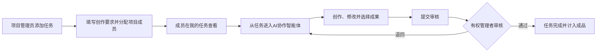

# 内容创作任务管理需求说明

日期：2026-09-24｜版本：v0.1｜状态：需求草稿，待评审｜关联需求：R07，衔接R08、R18、R19。

## 1. 目标与依据

在当前项目内，由项目管理员安排内容创作任务；项目成员查看分配给自己的任务，并从任务进入AI协作智能体完成内容创作。任务为管理交付要求和责任人的业务对象，与智能体中的会话、模型执行记录区分。

**本次用户明确：** 项目管理员可添加、编辑、分配任务；项目成员可查看分配给自己的任务，并通过任务进入AI协作智能体创作。

**继承已有共识：** 当前项目的数据隔离；成员选择成品提交审核，审核通过后任务完成并计入成品数量（D043）；既有D044还要求有权管理者审核、删除、归档及查看项目内全部任务。上述审核和历史管理能力保留，角色与“项目管理员”的映射待Q22确认。数据统计沿用R19，不在本稿重新定义口径。

依据：[业务共识](../02_需求与共识/AI课件协作平台-业务流程与需求共识.md#任务管理与项目数据统计补充d044d0452026-09-18)、[R07需求梳理](../02_需求与共识/AI课件协作平台-项目需求梳理.md)、[协作专题设计](协作任务、数据看板与权限-需求说明.md)及用户2026-09-24本次要求。

## 2. 角色与可见范围

| 操作 | 项目管理员 | 项目成员 |
|---|---|---|
| 查看任务 | 查看有权管理的当前项目任务；是否所有项目管理员均可查看全部任务待Q22 | 仅查看当前项目分配给自己的任务 |
| 添加、编辑、分配 | 可操作；分配对象须为当前项目有访问权的成员 | 无权限 |
| 进入AI创作 | 如自身被分配，可按成员身份进入；管理员代成员创作的规则待确认 | 从本人任务进入，查看任务要求并创作 |
| 提交审核 | 如自身为任务负责人，按成员规则提交 | 选择本任务成果提交 |
| 审核、删除、归档 | 继承D044的管理能力；具体授予哪些项目管理员待Q22/Q25 | 无权限 |

权限必须作用于列表、搜索、详情、直达链接、关联会话及成果接口。成员不能通过修改链接或筛选条件看到他人任务；跨项目任务、资源、会话和成果不可混用。项目管理员身份如何对应原“部门主管”，以及是否存在仅能派工、不能审核的管理员，属于Q22待确认范围。

## 3. 核心流程

### 3.1 添加、编辑与分配

- 入口：当前项目的“任务管理”。管理员可添加任务，填写任务名称、创作要求、交付要求和负责人；参考资料、截止时间、优先级属于建议字段，是否必填及具体枚举待评审。任务编号、创建人和创建时间由系统记录。
- 分配时只允许选择当前项目有权访问且账号可用的成员。保存成功后，成员的“我的任务”可见新任务；通知方式待确认，不把外部消息作为添加成功的必要条件。
- 管理员可编辑任务要求及负责人。应记录修改人、时间和变更内容；成员已开始创作后的要求变更，应让成员可见，提交审核时能追溯当时要求。改派后的历史创作与用量不直接改记给新负责人。
- 同一任务是否可分配多人、是否交付多个课件、发布前是否有草稿态，均待Q19确认；本稿不据页面建议固定为单人单课。

### 3.2 我的任务与任务详情

- 成员进入当前项目后，可在“我的任务”查看本人获分配任务；列表至少识别任务名称、当前状态、负责人及可执行的“开始/继续创作”入口。具体排序、筛选和逾期展示待页面设计。
- 详情展示当前任务要求、交付要求、相关资源、负责人和历史关键记录。无权或已失去项目访问权时不得展示任务正文、关联成果或会话。
- 管理员查看项目任务、筛选与编辑；管理员的项目范围和审核权限由Q22决定，不因拥有系统管理员账号而自动获得业务数据权限。

### 3.3 从任务进入AI协作智能体

- 点击“开始/继续创作”时带入当前项目和任务标识；在智能体页面展示任务名称、要求及返回任务详情的入口。首次进入可建立关联会话，续做可返回该任务关联的会话，具体一对多关系待Q19评审。
- 会话、上传、模型执行、用量和成果应能追溯到所属项目、任务及实际操作者；切换任务后不得沿用上一任务的上下文或把后台回调归到当前打开的任务。
- AI生成成功、保存成果到资源库、提交审核和任务完成是不同事件。生成失败不应直接将制作任务标为完成或失败；既有成果与任务关联应保留。

### 3.4 提交、审核及后续管理

- 成员选择本任务成果的固定版本提交审核，系统保留成果标识、版本、提交人、时间和说明。提交后进入待审核；有权管理者通过后才将任务标为完成并计入成品。退回须保留意见，成员可继续修改并重新提交。
- 已有D044要求有权管理者可删除、归档任务；已形成的创作、用量与审核记录须可追溯。删除、归档、取消的适用情形及恢复规则待Q25，不在此将建议状态流转升格为已确认规则。
- 成品去重、撤回或作废后的完成状态与统计修正待Q20；计时和Token归属待Q21；任务完成率口径待Q24。

## 4. 验收场景（按已确认主线）

1. 项目管理员在项目A添加并分配任务给项目A成员甲后，甲在项目A的“我的任务”看到该任务；未被分配的成员乙无法通过列表、搜索或链接读取该任务。
2. 项目管理员编辑任务要求或负责人后，获分配成员看到当前要求，系统保留变更记录；原操作者的历史创作记录不会随改派消失。
3. 甲从该任务进入AI协作智能体，页面能识别当前任务；对话和生成成果可回到该任务，且不会混入项目B数据。
4. 甲选择成果提交后，任务进入待审核；只有审核通过后才标为完成并计入成品。审核退回后可继续创作和再次提交。
5. AI执行失败或成果仅保存至资源库时，任务不会自动变为已完成；无权访问或项目成员关系被撤销后，不可继续读取任务与关联创作内容。

## 5. 待确认与评审重点

| 编号 | 问题 | 影响 |
|---|---|---|
| Q19 | 单任务负责人/课件数量、任务与多个会话的关系、自主创作是否保留 | 数据结构、入口与提交粒度 |
| Q20 | 成品版本、重复提交、撤回/作废 | 审核和成品计数 |
| Q21 | 改派后的贡献、有效创作时长和Token归属 | 过程证据与统计 |
| Q22 | “项目管理员”与原“部门主管”如何映射；谁可查看全部任务、审核和管理历史 | 角色授权和数据范围 |
| Q24 | 完成率分母及跨期口径 | 数据看板，不阻塞任务主流程 |
| Q25 | 删除、归档、取消与恢复规则 | 历史证据及可操作状态 |

本稿为需求梳理，不代表首版范围、页面原型、研发排期或功能实现已获确认。
