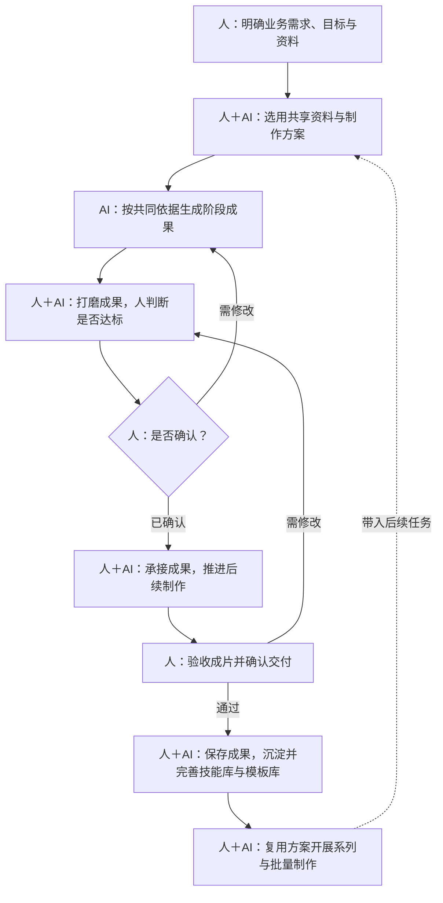
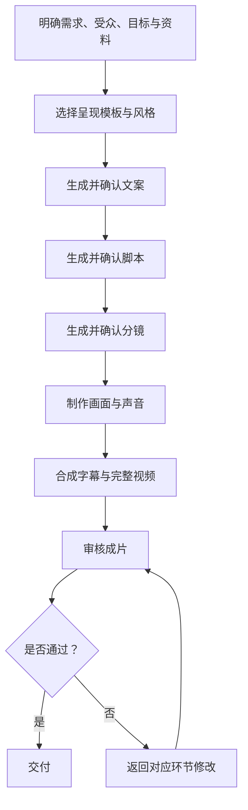
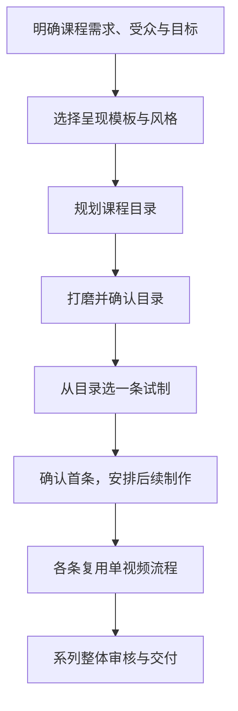

# AI课件协作平台：业务流程与需求共识

**日期：** 2026-09-12　　**版本：** v0.36  
**用途：** 用于管理层了解平台价值与整体工作方式，并作为业务需求沟通的基础；具体制作细节待业务确认。

## 1. 业务现状

- **制作方式：** 课程和视频仍按传统方式制作，文案、动画同事分别完成各自环节，制作过程依赖人工衔接，难以形成贯通全流程的生产能力。
- **AI 应用：** 同事已经使用 AI，但主要用于个人工作中的单个环节，各自采用自己的方法，应用经验难以转化为团队统一、可复用的做法。
- **协作流程：** 团队尚未形成贯通文案、脚本、分镜和制作的 AI 协作工作流，各环节的 AI 应用仍相对分散，整体提效受到限制。
- **资产保存：** 文案、动画等资料和制作成果分散保存在同事个人电脑上，不利于公司统一积累、查找和复用这些核心资产。
- **成本与时效：** 传统制作方式依赖较多人工投入，制作成本较高、交付周期较长，影响内容交付的及时性和业务响应速度。
- **规模化需求：** 市场业务需要大量培训内容，生成方式也多种多样，包括批量制作、按需或个性化生成等；传统制作方式难以支撑这样的规模和多样化生产需求，制约相关业务开展。

## 2. 需要解决的问题与对应思路

| 综合提炼的问题 | 对应解决思路 |
|---|---|
| 分散的制作环节和个人 AI 实践，尚未形成团队可复用的生产能力 | 梳理实际业务流程，沉淀共享制作方法、技能和模板，逐步贯通文案到成片的协作 |
| 制作成本较高、交付周期较长，难以及时响应业务需求 | 利用 AI 辅助制作、复用已有成果并衔接生产环节，在保证内容质量的前提下降低制作成本、缩短交付周期 |
| 资料、成果和制作经验缺少公司层面的统一沉淀与复用机制 | 在公司内部集中积累文稿、素材、成片及制作依据，支持查找、复用和持续完善 |
| 现有生产方式难以支撑规模化交付及未来按需、个性化生成 | 在可复用制作方案基础上逐步提高生产效率和批量能力，再探索按业务输入调用生成能力；实时性另行验证 |

## 3. 总体目标与平台定位

### 总体目标

- **降本提效：** 在保证内容质量的前提下，降低制作成本、缩短交付周期，提高业务响应速度。
- **沉淀公司能力：** 将内容资产、制作方法与 AI 生产流程积累为公司可持续复用的核心能力。
- **支撑规模化业务：** 满足大量培训内容生产需求，逐步支持批量、按需、个性化等多种生成方式。

### 平台定位

面向垂直行业培训内容的内部 AI 生产与协作平台，作为上述解决思路的一种落地方式：

| 承载方向 | 平台发挥的作用 |
|---|---|
| 贯通生产 | 连接需求、文案、脚本、分镜、制作与交付，让 AI 能力融入完整业务流程 |
| 积累与复用 | 集中沉淀文稿、素材、成片，以及技能、模板和制作方案，支持团队持续使用和完善 |
| 扩展生产能力 | 从单条视频制作延伸到系列课程生产，在流程成熟后逐步提高自动化程度 |

围绕这一定位，先说明人、AI 与平台如何共同完成内容生产，再展开单个视频与系列课程两类业务场景。

## 4. 整体工作方式与业务流程

### 4.1 整体工作方式

**图示说明：** 整体流程图的每个节点标明参与方：人为人工判断或操作，AI 为生成执行，人＋AI 为共同完成。平台贯穿全程提供工具衔接和成果保存；节点仅展示工作内容与参与方。具体制作能力及批量、按需生成方式仍待业务确认。

**希望实现的变化：** 将依赖个人经验、分环节手工制作的工作方式，逐步转为人围绕业务目标组织 AI 完成制作、把关质量，团队共同积累和复用成果与制作方法，以降低成本、缩短交付周期并支撑规模化生产。

**主要提效环节：** AI 辅助生成目录、文稿及视听内容，减少从零制作的人工投入；复用素材与制作方案，减少重复劳动；平台承接成果，减少查找和传递资料的时间。保留人的专业判断与验收，实际节省程度需结合修改和返工验证。

| 参与方 | 在整体工作中的作用 |
|---|---|
| 人 | 明确业务目标、提供专业依据、选择和调整方案、确认阶段成果、验收交付；专业同事持续打磨制作方法 |
| AI | 按需求和共享制作依据，辅助规划、生成文稿与视听内容、执行检查，并根据反馈修改；具体能力由业务验证 |
| 平台 | 承接任务和资料，连接对话、技能及制作工具，保存各阶段成果与进展，让团队能续做、协作和复用 |

**推进方式：** 初期由人逐步确认并推进，AI 完成适合的制作工作，必要时人工接手；待方法稳定后，再将可重复步骤编排为工作流，提高自动化程度。动画同事维护可复用的呈现模板与制作方案，文案同事选用并参与内容制作，各自的专业经验逐步成为团队共享能力。

这套工作方式适用于以下两类场景：单视频围绕一条需求完成制作；系列课程先规划目录，再复用单视频流程逐条生产并整体验收。

### 4.2 单个视频

AI 按需求和选定方案辅助生成文案、脚本、分镜及视听内容，人负责确认、调整和最终验收；制作中需要时由人工或现有工具补足。

模板可人工选用，也可由 AI 按受众、诉求和预期目标辅助推荐；无合适模板时提示新增，由动画同事参与维护，具体做法待沟通。模板未完成时可先做草案样片并迭代，不形成“必须先完成最终模板才能试稿”的循环。

### 4.3 系列课程

AI 辅助规划课程目录并执行各条视频制作，人确认整体规划、首条效果与后续安排，并进行整套验收；每条视频沿用单视频流程的分工。

首条可直接作为系列中的一条；验证后复用共同模板/制作依据，不复制首条文案，每条保留自身目标和内容。手动优先，批量创建支持方向保留但规则和投入分期待业务确认；批量建任务不等于全量立即生成。

## 5. 技能库与模板库

为让上述流程中的制作经验能够反复使用，平台规划通过技能库沉淀制作与检查方法，通过模板库呈现效果样例并关联制作方案；两者共同支持团队复用，具体管理形式仍可随业务验证调整。

| 对象 | 主要用途 | 使用关系与当前边界 |
|---|---|---|
| 技能库 | 管理文案、脚本、分镜、BGM、视频生成、通用检查、审查及系统内置等某类工作的制作方法或能力 | 技能独立管理；AI 在对话中按需调用；一阶段可多技能，同技能可跨阶段；未来工作流可组合引用技能，不绑定节点 |
| 模板库 | 展示可预览的成片效果，沉淀可复用的呈现风格、内容结构、制作方案和必要素材依据 | 模板可关联一个或多个技能/流程/素材，也可共用技能；动画同事维护，文案同事选用；模板要求在文案或系列规划前生效 |
| 项目可用范围 | 让同一协作范围共享共同资料、模板和可用技能，支持多人制作方法一致 | 公共技能与项目专用/项目可用集合方向已认可；项目与课程包层级、课程/视频层级、系列内多模板例外及具体组织和维护责任待确认 |

**持续沉淀：** 制作中形成的有效方法和呈现方案，由专业同事打磨为可复用技能与模板，保存后供后续任务选用，并根据实际使用反馈继续完善；动画同事负责模板维护。库的独立管理功能仍按实际需要决定。

模板与技能有关联但不等同：不是一模板一技能，也不是一阶段一技能。共同依据支持一致性，但不承诺完全一致或当前已全部实现；技能库和模板库的独立管理功能是否首版建设按验证需要决定。

## 6. 协作和成果

业务流程还需要连接人员、任务和制作成果：通过课程目录组织视频任务，让参与者了解各条进展，并在持续沟通中查看、打磨和确认文稿及成片。以下归纳这些关系及当前共识。

| 业务关系 | 当前共识 |
|---|---|
| 目录与任务 | 课程包下有可视目录，视频条目关联单视频制作任务；目录保留教学结构和顺序，任务关注负责人、当前阶段和结果。 |
| 多人协作 | 视频可分配给不同人员并行；负责人看系列整体进展，制作人员聚焦本人任务。首版先满足基本归属、进度/结果可见和选任务进入制作，个人聚焦不等于权限隔离，复杂权限后置。 |
| 工作台方向 | 同一任务内连续对话承接已确认成果，同时保留独立文案、脚本、分镜成果和确认状态；这是推荐待验证方向，不等于已确定界面或跨任务统一聊天。 |
| 公司资产沉淀 | 文案、脚本、分镜、素材、成片及制作依据在公司内部平台保存并关联所属任务或课程，支持后续查找、续做与复用；具体归集方式待业务沟通，不以先建设独立资产管理模块为前提。 |
| 人工确认 | 文案、脚本、分镜和最终成片均保留人工确认；一个负责人可完成多个确认，需要时邀请专业同事。 |

## 7. 待业务沟通

下周优先了解真实业务流、工作流、困难和需求，逐项记录结论与未解决点；本清单不预设专业字段或最终优先级。

1. **需求、资产与专业成果：** 资料不足如何补齐、交付要求如何确认；哪些文案、脚本、分镜、素材、成片和制作方法需要归集、检索、复用，实际痛点是什么；三个成果怎样区分和衔接，各自需要哪些输入输出、反馈和确认标准。
2. **制作衔接与成本时效：** 了解各环节人工投入、等待时间、制作费用和主要返工来源，明确哪些环节适合 AI 辅助或成果复用； 分镜到素材、镜头、配音、BGM、合成所需的最小制作依据；哪些由 AI、人工或现有工具补足；粗预览/逐镜复核、节奏音画字幕如何确认。
3. **模板与技能：** 模板预览、人工选用、AI 推荐、无匹配新增和草案打样如何实际配合；技能怎样维护、按需调用和组合，推荐后怎样选用；公共/项目可用范围及系列规划是否沉淀为技能；技能更新与既有任务的处理规则保留为后续事项。
4. **审核返工与异常：** 成片问题如何由负责人定位人工修改环节，哪些下游重做并再次验收；生成失败或不理想时如何重做或人工接手；检查技能如何核对成片与文案、脚本要求是否一致。自动同步、影响识别、联动重做后续再议。
5. **系列协作与交付：** 目录如何转任务、课程/模块/视频如何对应、每条成果如何归属；批量、按需、个性化等生成方式的实际需求、内容差异和交付时效；首条复用范围和批量启动规则（批量建任务不等于立即全量生成）；人物、风格、术语和声音如何一致；整套是否重复、遗漏、衔接顺畅；交付对象和文稿、素材、成片如何保存。
6. **工作台与任务管理：** 同一任务连续对话中如何查看当前阶段/成果、回看回改和进入下一阶段；任务负责人、基本状态/待处理事项、系列总览和个人聚焦如何满足最小使用；用典型任务验证基本可用性。
7. **后续可选验证：** 需求了解后，再考虑用真实视频及小系列试制；不作为下周沟通前提，不预先安排或排序。复杂权限、排期优先级、通知统计和复杂接手规则后续再议。
8. **产品/研发边界：** 资源、工期、技术栈、部署和学习平台对接另行对齐，不由业务同事承担技术决策；不以复杂批量调度或全面自动化为首版前提。

## 8. 规划与落地边界

| 内容 | 当前处理方式 |
|---|---|
| 需求了解 | 下周先听业务实际做法与诉求，不急于排优先级或锁定实现范围 |
| 基本制作流程 | 先用必要的技能、素材与制作方案跑通，具体衔接由业务团队确认 |
| 技能库、模板库及 AI 推荐 | 整体规划保留；是否独立建设管理功能，按实际需要决定 |
| 规模化与多种生成方式 | 系列课程复用是当前流程基础；批量、按需、个性化生成的触发方式、制作差异和时效需求需进一步了解，不将批量建任务视为已具备规模化生成能力 |
| 专业方法与界面 | 输入输出、技能效果、交互方式待沟通，不预先定死 |
| 管理与自动化扩展 | 权限、库版本审核、复杂调度、自动同步与联动重做后续再议 |

- **推进方向：** 了解需求 → 对齐流程 → 开发基础平台 → 在使用中迭代。
- **后续验证：** 可在相近内容与质量要求下，对照历史任务了解人工投入、AI/工具费用、整体交付周期和返工情况，判断是否实际降本提效；同时关注成果能否再次找到并复用、系列生产是否一致。不预设改善比例，也不要求新增统计功能。

维护规则：后续讨论以本文件为准，将新共识合并到对应章节，明确替代旧说法并区分已确认、推荐和待沟通内容。

**v0.36 变更说明（2026-09-12）：** 整体流程保留人机分工；单视频与系列课程图仅展示业务步骤，分工移至各图前的简短说明。

**沟通背景**

- 产品经理牵头候选框架；下周先了解文案、动画同事的实际工作流、困难和需求，专业细节共同打磨。
- 原有下下周启动开发的时间设想保留为背景，资源与安排待定；当前不急于排序或锁定范围。
- 真正可点击、有分支的互动课件及已有自研学习平台对接，暂不深入。

**历史记录**

v0.1–v0.19：持续记录单视频与系列流程、模板前置、技能库、目录任务、多人协作、连续对话候选、首版范围收敛、模板与技能关联及历轮审查调整。完整旧文档已备份。

