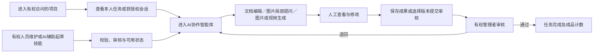

# AI课件协作平台迭代需求文档

版本：v0.1｜日期：2026-09-24｜状态：需求分析草稿，待业务与研发评审

## 1. 依据、目标与范围

用户明确下一步开发[需求清单截图](../01_业务资料/外部材料/2026-09-24-迭代需求清单/原始需求截图.png)中的八项。本稿将八项全部纳入**本轮需求分析范围**，逐项说明目标、建议的使用闭环、验收场景和待确认决定。截图只有条目名称，不提供界面细节、交付格式、权限矩阵或验收指标；文内凡超出截图和既有共识的规则均标为“建议／待确认”。本稿不等于需求评审通过、研发排期或实现完成。

本次迭代目标：让项目成员在同一项目内接收内容创作任务，利用智能体产出和修改文档、图片、视频；让有权人员维护可复用技能，并以项目权限保护任务、资源、会话和成果。沿用现有项目隔离、人工确认、手动入库及任务审核原则，不据此增加跨项目共享或自动发布。

| 迭代编号 | 截图原项 | 对应既有需求 | 本稿处理 |
|---|---|---|---|
| I01 | 【AI协作】UI视觉优化 | R08；PG11、系统设计规范 | 明确需确定页面与状态基线，形成可核验的视觉优化范围 |
| I02 | 【AI协作】增加文档在线编辑相关功能 | R08/R09；课件编辑器Q26/Q27 | 扩展原只读文档画布；编辑对象与格式待确认 |
| I03 | 【AI协作】增加图片局部固定提问相关功能 | R08；PG11图片反馈 | 将当前“围绕整图提问”细化为局部区域定位，操作语义待确认 |
| I04 | 【AI协作】增加AI创建和编辑技能的相关功能 | R10；Q16/Q23 | 在原文件上传维护之外增加AI辅助起草与修改，保留人工审核 |
| I05 | 【AI协作】优化文生图、图生视频的基础能力 | R04/R08/R14；Q10/Q11/Q12 | 界定两条生成链路及服务接入、成果、失败处理 |
| I06 | 【技能管理】优化技能新增、编辑、调用能力 | R10；PG13/PG18；Q16 | 贯通维护、可用状态与智能体调用，区分I04的AI辅助 |
| I07 | 【任务管理】增加任务管理和分配流程 | R07；D049 | 复用已形成的任务管理主线，衔接创作与审核 |
| I08 | 【账号权限】完善项目权限控制 | R11/R18；Q04/Q22/Q23 | 形成项目访问、角色操作和对象归属的统一校验范围 |

截图的“优化”不证明旧功能已在正式平台上线。现有HTML/Figma原型、需求说明与技能包分析仅作为设计及可行性依据；正式服务端能力需研发核验。需求池的“区域拖拽调宽”“上传格式扩展”“整类资源关联”“技能保存后自动运行验证”属于另外四项历史诉求，与本截图可能有关联，但**不能仅凭相似名称自动并入八项范围**；如合并，应在评审时指明原条目及去重结果。

## 2. 共同业务链路与数据边界

制作任务、创作会话、生成执行、文档/图片/视频成果、技能定义是不同对象。资源、任务、会话及成果关联当前项目；全局技能与项目专属技能沿用D047/D048作用域。AI生成成功、文档保存、资源入库、任务提交及审核通过分别记录，不能互相替代。项目成员能否自主发起无任务创作沿用Q19，不由本稿新增强制规则。

## 3. 逐项需求分析

### I01 AI协作界面视觉优化

**目标与现状。** 提升成员在聊天、任务会话、内容画布和成果清单之间查找与操作的清晰度。现有PG11已有导航、会话任务列表、聊天、画布、成果清单及部分视觉规范；截图未指出具体缺陷、目标页面或期望效果。

**建议／待确认的交付范围。** 以现有系统设计规范和PG11真实页面为基线，评审时逐页圈定初始态、文档、图片、视频、生成中、失败和窄窗口等需调整的状态。交付前后对照图、交互原型和组件规则；重点核对信息层级、留白、阅读宽度、操作可发现性、不同状态的一致性和可读性。收集001的“三区拖拽调宽”是独立功能诉求，是否作为本项子范围需单独确认。

**验收场景。** 对评审确定的页面及状态，按批准的对照图和系统规范核对布局、文字、组件状态及缩放/窄窗口行为；聊天、画布、成果切换和未发送草稿保持可用。无批准的视觉基线时，不能仅以“更美观”判定通过。

### I02 文档在线编辑

**目标与现状。** 用户希望在AI协作界面直接调整文档内容。当前PG11文档画布按已确认共识只读；课件编辑器草稿主要讨论可编辑课件工程，明确未扩展为通用文档编辑器。因此本项是新的范围扩展，不能拿课件编辑器原型视为文档编辑已确认。

**建议／待确认的最小闭环。** 从本人有权访问的文档成果进入编辑态 → 修改正文 → 保存并形成可回看的版本 → 重新打开继续编辑 → 选择确定版本用于后续AI协作、手动入库或任务提交。编辑中保留原成果与操作者记录；离开前有未保存改动时提示；保存失败不覆盖上一个成功版本；同一文档并发写入须检测版本冲突。标题、段落、列表可作为首轮编辑对象候选，表格、附件、批注、多人实时协同及DOCX/PDF往返编辑均需单独确认。是否允许编辑资源库中上传的原始文档、是否支持AI直接修改文档、正式保存与导出格式，也需评审决定。

**验收场景。** 在获授权项目打开可编辑文档，修改并保存后刷新仍可看到新内容；保存失败、版本冲突和无权限访问均不丢失已成功版本或泄露其他项目内容。只读或不支持格式明确给出原因，不显示无效编辑入口。

### I03 图片局部固定提问

**目标与现状。** 成员针对图片的特定区域提问或提出修改意见，减少“这里”“右上角”指代不清。当前PG11支持围绕整张图片提问，尚无可持续定位的局部锚点。

**建议／待确认的交互。** 打开图片后选择一个区域，在画布上显示固定标记，并将该区域与原图标识、版本、位置及本次提问绑定；聊天消息和图片画布可互相定位。移动、缩放或全屏查看图片时标记仍指向同一内容区域；用户可撤销或重新选择，发送前能看到提问目标。若生成了新版图片，原标记仍归属原版，不默认迁移。需决定“提问”仅用于理解/解释，还是也可触发局部重绘；遮罩、多个区域和多人评论不据截图自动纳入。

**验收场景。** 对图片局部选择并发送提问后，历史消息可重新定位原图原区域；切换图片、缩放、刷新或新版生成不把锚点错挂到别的成果。无图像权限、原图失效或定位数据不可用时给出明确状态。

### I04 AI创建和编辑技能

**目标与现状。** 让有权人员以需求描述为输入，由AI辅助形成技能草稿或修改建议，降低手工编写技能包的成本。现有技能管理主要是文件/ZIP上传、解析、字段维护和状态控制，AI生成技能内容尚未设计。技能生成也不等于技能可安全运行。

**建议／待确认的最小闭环。** 有权用户描述技能用途、输入、输出和限制 → AI生成技能候选内容及文件清单 → 用户预览、调整并确认 → 进入I06既有新增/编辑流程 → 按权限及校验规则决定能否发布/启用。编辑已有技能时固定基于版本，展示前后差异；未确认的AI候选不覆盖当前可用技能。脚本或外部依赖若由AI生成，执行权限、环境隔离和可运行验证必须由Q16及收集004的独立规则约束。成员的“申请修改”与有权主管的直接维护沿用D042，不能通过AI入口绕过审批。

**验收场景。** 生成候选失败保留用户输入和旧版技能；用户放弃候选不改变已生效技能；确认后的技能可追溯来源、操作者和版本，越权用户不能直接发布或替换全局技能。

### I05 文生图、图生视频基础能力

**目标与现状。** 支撑课件配图与片段视频制作。现有需求确认可通过对话生成视频，但实际模型、图像服务、视频链路和质量标准仍在Q10—Q12；本地技能包包含候选方法，不证明平台已接入真实生成服务。

**建议／待确认的两条链路。** 文生图：成员输入文字要求，可按项目授权引用资料，发起生成并查看结果，保留提示词、模型/工具、执行状态和图片成果。图生视频：选择本项目有权使用的图片，输入运动、镜头或变化要求，发起生成并查看视频成果，记录源图版本与生成参数。两者均支持失败原因和重新发起，成功成果进入当前会话清单，可按现有规则手动入库；后台执行完成不自动完成业务任务。生成尺寸、时长、画面比例、模型选项、并发/超时、费用、素材权属、敏感内容及质量验收样片待研发和业务评审，不在草稿中虚设数值。

**验收场景。** 文本输入能产生可查看、可追溯的图片；获授权图片能产生可播放且可追溯源图的视频。失败、超时或无权限时不生成伪成功成果；重复请求和回调不会混淆所属项目、会话与任务。基于真实服务和认可样片再验证质量，不以静态演示文件代替。

### I06 技能新增、编辑、调用优化

**目标与现状。** 打通技能维护到智能体实际使用的链路。已有全局/项目专属技能类型、文件上传、解析和状态原型；调用机制、版本生效和真实执行尚待Q16。

**建议／待确认的范围。** 新增及编辑继续支持手动上传技能包和I04产生的候选，保留入口文件与附件、校验错误及版本记录；全局技能在系统管理维护，项目专属技能在所属项目维护，项目内全局技能只读且状态跟随全局。智能体仅展示当前项目可用技能；成员按授权选择或由系统调用技能时，应记录技能标识、版本、调用人、任务/会话及成功或失败结果。新版本何时影响正在进行的会话、自动选择与手动选择的关系、单次多技能调用顺序、可运行性验证是否为发布前置条件、删除引用保护，均待Q16/Q23评审。收集004的“保存后自动运行验证”不能被笼统的“调用优化”默默吸收。

**验收场景。** 新增/编辑失败保留旧版与输入；项目A专属技能不出现在项目B；停用或无权技能不可用于新请求；一次实际调用可回溯所用技能及版本，失败不会被显示为成功。AI创建的技能与手工上传技能走相同权限和可用性校验。

### I07 任务管理和分配流程

**目标与依据。** 沿用[任务管理需求说明](任务管理-需求说明.md)及D049：项目管理员添加、编辑、分配内容创作任务；项目成员仅查看分配给自己的任务，从任务进入AI协作智能体。D043要求成员提交审核、有权管理者审核通过后任务完成并计入成品。任务与会话/执行分开管理。

**本迭代闭环。** 管理员填写任务与交付要求并分配当前项目成员 → 成员在“我的任务”查看 → 从任务进入绑定项目/任务的创作会话 → 选择固定成果版本提交 → 有权管理者审核通过或退回。编辑、改派需留痕；删除、归档的细则沿用Q25。一个任务能否多人/多个成品、管理员和原“部门主管”的角色映射、审核授权仍待Q19/Q22。原任务专题中的建议字段、状态及通知方式不直接当作已确认开发规格。

**验收场景。** 被分配成员能看到任务并进入正确创作上下文，其他成员不能通过链接读取；改派不抹除历史；AI生成成功不直接完成任务，审核通过才完成和计数。完整场景见任务专题第4节。

### I08 项目权限控制

**目标与现状。** 保证上述八项能力在项目、角色及对象层面按同一规则生效。项目数据隔离已确认，但正式认证、服务端授权、完整角色矩阵和管理范围尚待Q04/Q22/Q23；本地原型的按钮隐藏不等于权限实现。

**建议／待确认的权限维度。** 先确认项目成员关系、项目管理员、原部门主管、系统管理员及技能维护/审核人的映射，再按“项目访问＋对象归属＋操作授权”定义矩阵。覆盖任务列表/详情/分配/审核，文档与图片编辑、生成与下载，技能创建/编辑/调用/启停，资源入库、会话、历史版本和数据导出。列表、搜索、直达链接、接口请求和后台生成结果均校验；角色或项目成员关系撤销后阻止新的访问和操作，历史审计记录保留。系统管理员不因维护账号而自动取得全部业务内容访问权。已有后台任务在撤权后的收尾方式待Q27/Q22。

**验收场景。** 同账号在项目A与项目B看到的数据按授权隔离；普通成员不能编辑或审核他人任务、发布技能或访问他人文档版本；直接调用接口与页面操作结果一致。权限变更生效后，新访问按新权限判断，历史记录可供授权人员追溯。

## 4. 共同验收与依赖

1. **项目与对象归属：** 八项新增或修改的数据都记录项目及操作者；跨项目链接、搜索、引用、生成回调、导出与下载均不能串数据。
2. **人工确认与版本：** AI候选、生成结果、编辑保存、资源入库、提交审核和审核通过分别保留状态及依据；未确认候选不能静默替换已生效内容。
3. **失败与恢复：** 上传/保存/调用/生成/导出失败保留已成功版本及任务关系，提供可辨识原因与重试路径；不得用静态演示内容冒充实际生成。
4. **实施依赖：** I02依赖可编辑文档格式与持久化；I03依赖图片版本与区域定位；I04/I06依赖技能解析、版本、执行隔离和审批；I05依赖真实图像/视频服务及认可样片；I07/I08依赖项目身份、任务归属和服务端权限。研发需核对已有能力、接口和实际可复用范围，再估时。

## 5. 评审时必须明确的决策

| 事项 | 需要确定的内容 | 影响 |
|---|---|---|
| I01，Q29 | 视觉优化覆盖哪些页面/状态、对照基线是什么；收集001的区域调宽是否并入 | 设计范围与验收 |
| I02，Q30/Q26/Q27 | 编辑生成文档还是上传资源；首轮编辑元素、保存/导出格式、AI修改和版本策略 | 文档模型、编辑器工作量 |
| I03，Q31 | “局部固定提问”是区域问答、局部修改，还是两者；锚点形态及原图变化处理 | 交互与图像服务需求 |
| I04，Q32/Q16/Q23 | 谁能发起AI创建/编辑，候选包含哪些文件；申请、审核、验证与发布怎样衔接 | 权限、技能版本和安全边界 |
| I05，Q33/Q10—Q12 | 首轮文生图、图生视频服务和输入输出范围；认可样片、格式、容量及费用约束 | 可行性、成本、质量验收 |
| I06，Q16 | 手动/自动调用、版本生效、技能包限制与收集004是否单独纳入 | 调用链路与验证策略 |
| I07，Q19/Q20/Q22/Q25 | 单任务负责人/成果粒度、角色映射、审核及删除归档规则 | 状态、权限与统计 |
| I08，Q04/Q22/Q23 | 项目角色来源、完整权限矩阵、系统管理员和技能审核人的业务权限 | 服务端授权及验收 |

截图确定了八个讨论方向，但没有给出优先级、研发负责人、工时、上线日期或内部拆期。评审可先确认每项的业务边界与验收，再由研发核对技术依赖和历史实施状态；形成评审结论后才进入排期与禅道创建流程。

## 6. 参考资料与状态

- 原始输入：[2026-09-24迭代需求截图](../01_业务资料/外部材料/2026-09-24-迭代需求清单/原始需求截图.png)，仅包含八条名称与模块分组。
- 已确认基线：[业务流程与需求共识](../02_需求与共识/AI课件协作平台-业务流程与需求共识.md)、[R需求梳理](../02_需求与共识/AI课件协作平台-项目需求梳理.md)、[决策与待确认](../00_项目管理/决策与待确认.md)。
- 相关设计：[内容协作智能体说明](内容协作智能体-需求说明.md)、[课件编辑器草稿](课件编辑器-需求说明.md)、[技能与项目管理说明](项目与系统管理-需求说明.md)、[任务管理说明](任务管理-需求说明.md)。
- 关联但不自动并入：[项目需求池收集001—004](../02_需求与共识/项目需求池.md)及[下个版本需求池梳理](../05_评审与排期/下个版本-需求池梳理与开发候选.md)。

本稿属于需求分析草稿；各项“建议／待确认”只有经业务评审明确后，才转成开发验收口径。
